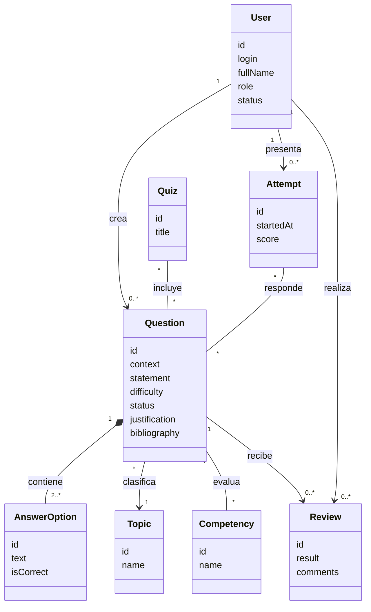

# Alcance de los puntos 1, 2 y 3 — Taller 10 JPA

## Aclaración del alcance

Los puntos 1, 2 y 3 **no solicitan migrar la aplicación Swing principal a Spring Boot ni cambiar su base de datos**:

- **Punto 1:** ejecutar y analizar el demo independiente de cursos, estudiantes y departamentos con JPA.
- **Punto 2:** analizar el dominio del Banco de Preguntas.
- **Punto 3:** diseñar y justificar su modelo de dominio mediante un diagrama UML.

La implementación de casos de uso y la persistencia JPA del Banco de Preguntas aparecen en puntos posteriores del taller. Por eso, la aplicación principal conserva su arranque Swing y SQLite. El demo JPA permanece separado en `jpa-clean-persistence-demo\jpa-clean-persistence-demo`.

## Ejecutar la aplicación principal

Requiere JDK 17 o superior y Maven. La aplicación principal usa SQLite y abre Swing:

1. Ejecuta `mvn test` desde la raíz.
2. Desde el IDE, ejecuta `com.taller2.Main` con el módulo raíz como classpath.

El programa inicializa `taller2.db` en el directorio de trabajo. Los archivos SQLite existentes no se eliminan ni se migran. La GUI necesita un entorno gráfico.

## Ejecutar el demo JPA del punto 1

Desde PowerShell, en la raíz del repositorio:

```powershell
Set-Location .\jpa-clean-persistence-demo\jpa-clean-persistence-demo
mvn spring-boot:run
```

El demo utiliza Spring Boot, Spring Data JPA y H2 en memoria. Su API queda en `http://localhost:8080` y la consola H2 en `http://localhost:8080/h2-console` (JDBC URL `jdbc:h2:mem:schooldb`, usuario `sa`, contraseña vacía). La base en memoria se recrea al reiniciar.

Para comprobar las operaciones:

```powershell
curl.exe -X POST http://localhost:8080/api/departments -H "Content-Type: application/json" -d "{\"name\":\"Computer Science\"}"
curl.exe -X POST http://localhost:8080/api/courses -H "Content-Type: application/json" -d "{\"title\":\"Persistence with JPA\",\"departmentId\":1}"
curl.exe -X POST http://localhost:8080/api/students -H "Content-Type: application/json" -d "{\"fullName\":\"Alex Morgan\",\"email\":\"alex@example.com\",\"studentNumber\":\"ST-1001\"}"
curl.exe -X POST http://localhost:8080/api/students/1/courses/1
curl.exe http://localhost:8080/api/departments
curl.exe http://localhost:8080/api/courses
curl.exe http://localhost:8080/api/students
```

El demo y la aplicación principal son programas diferentes. La aplicación Swing principal no levanta un servidor web; el demo JPA sí escucha en el puerto 8080.

## Punto 1 — Análisis del demo

El demo aplica una arquitectura en capas: `SchoolController` recibe solicitudes; `SchoolService` coordina casos de uso; `Student`, `Course`, `Department` y `Person` son el dominio; los contratos de repositorio mantienen independencia tecnológica; `StudentRepositoryJpa` implementa persistencia; los `*Record` mapean las tablas y `DomainMapper` convierte entre dominio y persistencia.

Agregar `@Entity` a `Student` acoplaría el dominio a Jakarta Persistence. El servicio depende del contrato `StudentRepository`, no del repositorio Spring Data, para que el almacenamiento pueda cambiar sin modificar el caso de uso. La separación entre `Student` y `StudentRecord` mantiene independientes el modelo de negocio y el relacional, a costa de mantener y probar el mapeador.

En las relaciones del demo, `CourseRecord.department` es propietario del uno-a-muchos/muchos-a-uno y almacena `department_id`; `DepartmentRecord.courses` usa `mappedBy = "department"` porque es el lado inverso. La matrícula de estudiantes usa la tabla intermedia `student_courses`. La estrategia `JOINED` guarda los datos comunes de `PersonRecord` en `people` y los atributos especializados en las tablas `students` e `instructors`.

## Punto 2 — Análisis del dominio

El dominio contempla administradores, autores, revisores, docentes y estudiantes. Incluye preguntas de selección única, opciones, clasificación académica, revisión, publicación, cuestionarios, intentos y resultados. El ciclo de vida propuesto es borrador, pendiente de revisión, en revisión, aprobada, publicada y archivada; una pregunta rechazada vuelve a borrador. Solo las preguntas aprobadas y publicadas deben usarse en simulacros.

La aplicación principal ya cuenta con un modelo más reducido y un ciclo de estados básico. El análisis de este punto no implica que todos los atributos y casos de uso del dominio completo deban construirse en esta entrega.

## Punto 3 — Diseño UML propuesto

El diagrama es una propuesta de dominio, no una indicación de que estas entidades ya estén implementadas ni de que deban anotarse con JPA en los puntos 1–3:



Las relaciones y restricciones representadas sirven como diseño inicial. La relación pregunta-competencia podría convertirse en una entidad asociativa si se necesita guardar atributos como el peso. La propuesta no anticipa una estrategia de herencia JPA; esa decisión pertenece a los puntos posteriores y requiere justificar los tipos de pregunta del alcance.

## Cambios conservados en la aplicación principal

Se mantuvo el ciclo de estados y el archivado lógico que ya estaban implementados antes de la migración de persistencia. El repositorio SQLite archiva una pregunta actualizando su estado, en lugar de borrarla físicamente. La documentación JavaDoc de esos cambios permanece en español.
