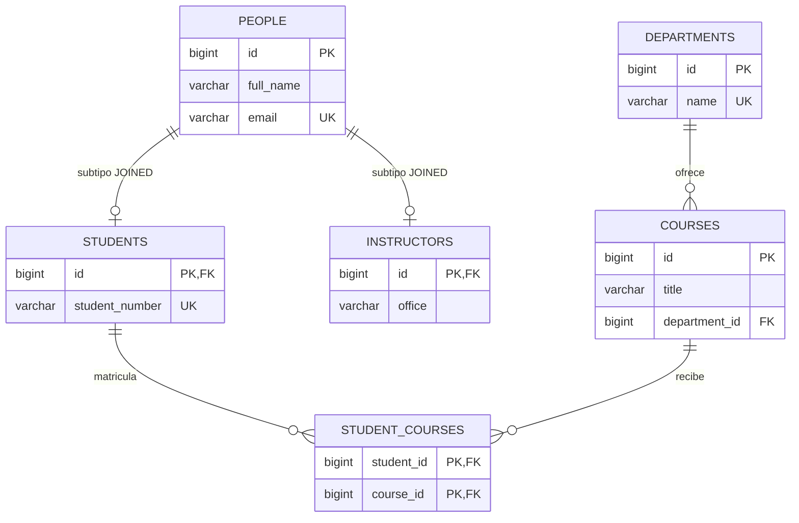
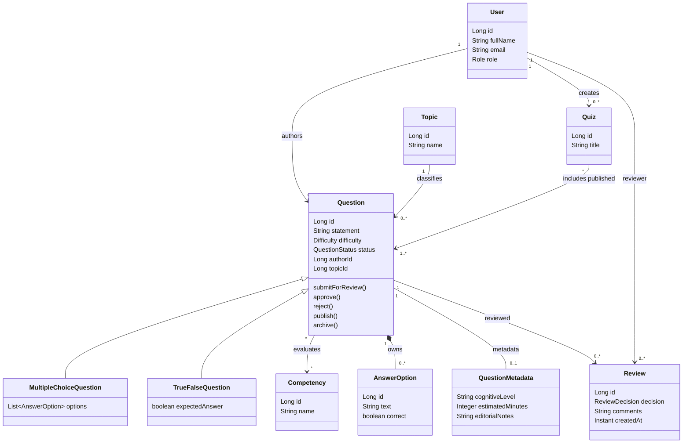
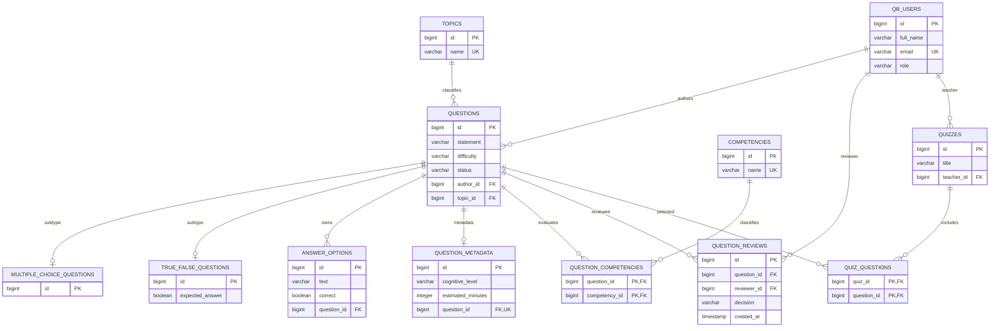

# Taller 10 — Análisis y diseño del Banco de Preguntas Saber Pro

## Alcance

El demo escolar se ejecuta por separado en `jpa-clean-persistence-demo\jpa-clean-persistence-demo`. La aplicación principal del curso continúa siendo Swing/SQLite. La solución implementable del Banco Saber Pro está en `question-bank-jpa`, como aplicación Spring Boot/JPA independiente; así se pueden estudiar y ejecutar ambas arquitecturas sin migrar ni alterar la aplicación existente.

## Parte I — Demo de cursos, estudiantes y departamentos

### Actividad 1.1 — Capas

| Elemento | Archivo o clase | Responsabilidad |
|---|---|---|
| Presentación | `api\SchoolController.java` | Expone endpoints REST, recibe parámetros HTTP, delega al servicio y devuelve respuestas. No implementa reglas de negocio ni accede directamente a JPA. |
| Aplicación | `application\SchoolService.java` | Coordina crear departamentos, cursos y estudiantes, matricular estudiantes y consultar registros. Depende de interfaces de repositorio del dominio. |
| Dominio | `domain\Student.java`, `Course.java`, `Department.java` (y `Person.java`, `Instructor.java`) | Representa personas, cursos y departamentos en objetos Java sin anotaciones ni imports de persistencia. |
| Contrato de repositorio | `domain\repository\StudentRepository.java` | Define operaciones de guardar, consultar y matricular estudiantes sin exponer Spring Data ni JPA. |
| Implementación concreta | `infrastructure\jpa\StudentRepositoryJpa.java` | Carga y guarda `StudentRecord`, resuelve cursos para matrículas, invoca Spring Data y convierte resultados al dominio. |
| Modelo JPA | `infrastructure\jpa\record\StudentRecord.java` | Representa la tabla y asociaciones JPA del estudiante; hereda los campos persistidos de `PersonRecord`. |
| Conversión de modelos | `infrastructure\jpa\DomainMapper.java` | Traduce entre dominio y records JPA, evitando que el dominio conozca relaciones, carga diferida y anotaciones de persistencia. |

**Respuestas**

1. Añadir `@Entity` a `Student` acoplaría una regla/modelo de negocio a Jakarta Persistence. El dominio tendría que cumplir requisitos del proveedor JPA y cambiaría junto con el esquema o la tecnología. También se volvería difícil probarlo o reutilizarlo sin JPA.
2. El contrato `StudentRepository` expresa lo que necesita el caso de uso. `SpringStudentDataRepository` es un detalle de infraestructura. Mantener el servicio contra el contrato permite cambiar la implementación sin reescribir el flujo de aplicación y probarlo con una implementación alternativa.
3. `StudentRepositoryJpa` traduce entre modelos, obtiene records, resuelve asociaciones, coordina operaciones con Spring Data y maneja la persistencia/transacción. Son responsabilidades de infraestructura; `Student` representa el estudiante y no debe abrir conexiones ni conocer tablas.
4. Separar `Student` de `StudentRecord` conserva un dominio independiente y permite adaptar el esquema relacional sin cambiar las reglas de negocio. El costo es mantener mapeadores, dos representaciones y pruebas para confirmar que no se pierden datos al convertir.
5. Se cambiarían dependencias y configuración JDBC, URL, credenciales, driver y dialecto; también habría que verificar DDL, tipos y restricciones. El contrato de `StudentRepository` y `SchoolService` pueden conservarse si la implementación JPA mantiene su comportamiento.

### Actividad 1.2 — Relaciones y esquema relacional

- `CourseRecord.department` es el lado propietario del vínculo departamento-curso: `@ManyToOne` y `@JoinColumn(name = "department_id")` escriben la FK `department_id` en `courses`.
- `DepartmentRecord.courses` usa `@OneToMany(mappedBy = "department")` porque es el lado inverso: `department` nombra el atributo propietario en `CourseRecord`. Evita crear una FK adicional o una tabla puente para una relación que ya se representa con `courses.department_id`.
- `@JoinColumn` declara la columna de FK y, con `nullable = false`, obliga a que cada curso pertenezca a un departamento existente.
- La matrícula estudiante-curso utiliza `student_courses`, con `student_id` y `course_id` como claves foráneas. El lado de `StudentRecord.courses` administra la tabla puente.
- Los cursos de un departamento se obtienen mediante una FK de cada curso al departamento (uno a muchos). Los cursos de un estudiante representan matrículas (muchos a muchos) y necesitan la tabla intermedia.



### Actividad 1.3 — Herencia

`@Inheritance(strategy = InheritanceType.JOINED)` mapea la jerarquía en tablas enlazadas por la misma clave primaria. `people` contiene `id`, `fullName` y `email`; `students` contiene `studentNumber`; `instructors` contiene `office`. El `id` de cada tabla hija también referencia la fila de `people`.

El dominio tiene su jerarquía `Person`/`Student`/`Instructor` en POJOs; la jerarquía independiente `PersonRecord`/`StudentRecord`/`InstructorRecord` incorpora las anotaciones. `SINGLE_TABLE` pondría todos los campos en una tabla con discriminador y valores nulos para atributos que no aplican a cada subtipo. `TABLE_PER_CLASS` duplicaría campos comunes en cada tabla concreta y haría más costosas las consultas polimórficas. `JOINED` normaliza los datos comunes y específicos, a costa de joins al recuperar subtipos.

### Actividad 1.4 — Ejecución y comprobación

Desde PowerShell, en la carpeta del demo:

```powershell
Set-Location .\jpa-clean-persistence-demo\jpa-clean-persistence-demo
mvn spring-boot:run
```

En otra terminal, ejecutar las operaciones en este orden:

```powershell
curl.exe -X POST http://localhost:8080/api/departments -H "Content-Type: application/json" -d '{"name":"Computer Science"}'
curl.exe -X POST http://localhost:8080/api/courses -H "Content-Type: application/json" -d '{"title":"Persistence with JPA","departmentId":1}'
curl.exe -X POST http://localhost:8080/api/students -H "Content-Type: application/json" -d '{"fullName":"Alex Morgan","email":"alex@example.com","studentNumber":"ST-1001"}'
curl.exe -X POST http://localhost:8080/api/students/1/courses/1
curl.exe http://localhost:8080/api/departments
curl.exe http://localhost:8080/api/courses
curl.exe http://localhost:8080/api/students
```

La consola está en `http://localhost:8080/h2-console`, JDBC URL `jdbc:h2:mem:schooldb`, usuario `sa`, contraseña vacía. Consultas útiles: `SELECT * FROM DEPARTMENTS;`, `SELECT * FROM COURSES;`, `SELECT * FROM PEOPLE;`, `SELECT * FROM STUDENTS;`, `SELECT * FROM STUDENT_COURSES;`. Al reiniciar el demo, H2 en memoria se recrea.

## Parte II — Dominio y UML

### Punto 2 — Actores y reglas

| Actor | Responsabilidad principal |
|---|---|
| Administrador | Gestiona usuarios, roles y parámetros. |
| Autor | Crea y corrige preguntas y su clasificación. |
| Revisor | Evalúa preguntas en revisión; aprueba o rechaza con comentarios. |
| Docente | Construye cuestionarios usando preguntas publicadas. |
| Estudiante | Presenta simulacros y consulta resultados; los intentos/resultados quedan fuera del alcance implementado de este módulo. |

La aplicación implementa `DRAFT → PENDING_REVIEW → IN_REVIEW → APPROVED → PUBLISHED → ARCHIVED`. Una decisión de rechazo desde `IN_REVIEW` vuelve a `DRAFT` y guarda un registro de revisión. La aplicación valida que una pregunta de selección tenga cinco opciones y exactamente una correcta antes de enviarla a revisión. Un cuestionario solamente acepta preguntas `PUBLISHED`.

### Punto 3 — Modelo de dominio propuesto



El modelo mantiene `QuestionMetadata` opcional para que una pregunta pueda crearse sin notas editoriales. Las preguntas requieren un autor y tema, y al menos una competencia para pasar a revisión. La asociación competencia-pregunta no tiene peso en este alcance; si se requiere, conviene modelar una entidad `QuestionCompetency` con el porcentaje y validar que las contribuciones sumen 100 %.

## Parte III — Decisiones e implementación JPA

El código ejecutable está en `question-bank-jpa`. Sus POJOs de dominio no importan `jakarta.persistence`; los `*Record` son la jerarquía JPA. `QuestionRepository`, `UserRepository`, `TopicRepository`, `CompetencyRepository`, `QuizRepository` y `ReviewRepository` son contratos; las clases `*RepositoryJpa` los implementan. Los servicios consumen esos contratos, no `JpaRepository`.

La jerarquía JPA elige `JOINED`: `questions` guarda atributos comunes y `multiple_choice_questions`/`true_false_questions` sus datos específicos. Facilita consultar campos comunes sin columnas de subtipo nulas y conserva la normalización; consultas polimórficas requieren joins. Las relaciones implementadas son:

| Relación | Mapeo y restricción |
|---|---|
| Pregunta–metadatos, 1:1 | `QuestionMetadataRecord` es propietario; `question_id` es FK única. Metadatos opcionales en el dominio, pero si hay registro debe pertenecer a una pregunta. |
| Pregunta–opciones, 1:N | La FK no nula `answer_options.question_id` está en el lado propietario `AnswerOptionRecord`; cascade y `orphanRemoval` mantienen las opciones junto con la pregunta. La regla de cinco opciones/una correcta se valida al enviar a revisión. |
| Pregunta–autor, N:1 | `QuestionRecord.author` posee `author_id`; la aplicación valida existencia y rol `AUTHOR`. |
| Pregunta–competencia, N:M | `question_competencies(question_id, competency_id)` guarda las dos FK; no necesita atributos adicionales para el alcance actual. |
| Cuestionario–preguntas, N:M | `quiz_questions(quiz_id, question_id)` permite compartir preguntas publicadas entre cuestionarios. |
| Pregunta–revisión, N:1 desde revisión | `question_reviews` conserva revisor, decisión, comentarios y fecha; el servicio guarda la decisión junto con el cambio de estado en una transacción. |

La creación/consulta de preguntas, clasificación, flujo de revisión y creación restringida de cuestionarios están disponibles por REST. La validación no está delegada al mapeo JPA: los servicios verifican roles, asociaciones existentes, opciones, estado y publicación antes de persistir. Las pruebas de integración con H2 verifican herencia, asociaciones y resultados de éxito/error.

### Esquema relacional del Banco Saber Pro

En las tablas de subtipo, `id` es simultáneamente PK y FK a `questions.id`. Las tablas de unión usan las dos FK como PK compuesta. `question_metadata.question_id` es además `UNIQUE`, que garantiza como máximo un registro de metadatos por pregunta.



### Reflexiones para sustentación

1. Dos modelos aíslan el lenguaje del negocio y el esquema relacional; el costo son conversores y el riesgo de mantener ambos sincronizados.
2. Se reemplaza la implementación `*RepositoryJpa` y su configuración/mapeo, pero se conservan contratos, dominio y casos de uso mientras el nuevo mecanismo implemente las mismas operaciones.
3. `@ManyToMany` directo sirve cuando la relación no tiene identidad ni datos propios. Si necesita peso, fecha o estado, una entidad asociativa hace explícitos esos atributos y sus restricciones.
4. Una asociación `LAZY` accedida una vez cerrada la transacción puede causar `LazyInitializationException`; conviene mapear a dominio/DTO dentro de la transacción y definir consultas de carga apropiadas.
5. `JOINED` es apropiada mientras los tipos comparten muchos atributos y se consultan polimórficamente. Muchos tipos con cargas específicas pueden hacer excesivos los joins; habría que medir consultas y evaluar `SINGLE_TABLE` o composiciones antes de cambiar estrategia.
6. La persistencia escribe/recupera datos; el ciclo de vida decide si una transición es válida. Separarlas permite cambiar la base de datos sin debilitar las reglas y probar estas últimas sin JPA.
